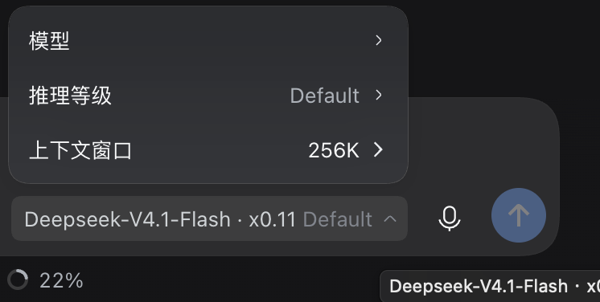
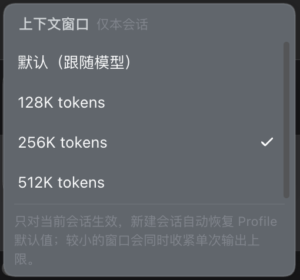

# 上下文窗口选择器 · dsh-context-window-picker

在 DSH 的**模型选择弹窗**里，为**当前会话**临时切换上下文窗口大小（`contextWindow`），
和「模型」「推理等级」并列成独立一行；新建会话自动恢复 Profile 默认值。

对标 WorkBuddy：模型详情面板中「思考强度」+「上下文窗口」两个配置项并列，会话级临时生效。





## 安装

```bash
git clone https://github.com/luyiheng1111/dsh-context-window-picker.git
```

然后在 DSH 的 Plugins 页面里用本地目录安装（Install from path / 本地 bundle）指向刚 clone 的目录，
或在终端：

```bash
dsh plugin --profile desktop add /path/to/dsh-context-window-picker
```

安装后重启 DSH 即可。插件没有构建步骤、没有运行时依赖（React 由宿主提供），
默认走 bundle patch 里的 `presets`/`completionRatio` 等默认值，无需任何配置。

## 交互

1. 打开输入框右侧的模型选择弹窗（或 `/model`）。
2. 弹窗面板里「模型」「推理等级」下方多出独立的一行 —— **上下文窗口  256K  ›**，
   右侧显示的是**当前生效**窗口；被本会话覆盖时该数字变为品牌色高亮。
3. 点这一行展开档位列表，选一个即可即时生效：
   - 默认（跟随模型）
   - 128K / 256K / 512K 等（只列出不超过当前模型默认窗口的档位；
     选中与默认相同的档位等同于回到「默认」）
4. 选择后立即写入当前会话，再发一条消息，`request/context` 事件里的上下文窗口即为新值。
5. 新建会话不携带该选择，自动回到适配器目录里的默认窗口。

因为这一行是渲染在弹窗面板**内部**的，点击它和它的档位列表都不会把弹窗关掉，
可以像原生配置项一样反复切换。

## 为什么不是「改 Profile 配置」

`defaultContextWindow` 是适配器目录（`llm-pi-ai.providers.*.models[].contextWindow` / `llm-deepseek`）
的全局值，改它会影响所有会话。本插件只在宿主内存里按 **sessionId** 记录覆盖值，
不写任何配置文件，也不写会话日志（不污染 session log）。

## 实现要点

- **宿主半** 在 `llm` 服务的原型上包装两个公开方法（插件卸载时精确还原）：
  - `llm.prepareCall(config, signal, configure)`：通过官方 `configure` 回调收紧 `maxTokens`，
    并在返回的冻结调用对象上把 `context.contextWindow` 换成会话覆盖值。
    这一步保证 `request/context` 事件、token 计量、压缩阈值看到的是同一个窗口。
  - `llm.resolveModelInfo(provider, model)`：`compaction-basic` 通过它取窗口，
    所以压缩压力判断同样使用会话覆盖值。
- `Session#requestHeader` 在覆盖生效期间夹紧 `config.maxTokens`，
  避免压缩策略拿旧的 256K 完成预留去比新的小窗口而直接抛错。
- **客户端半** 不替换原生模型选择组件，而是通过 `conversation.input.model.label` 槽位
  在弹窗里追加一行：用一个隐藏锚点向上找到持有 `role="menuitem"` 单元格的面板容器，
  再用 `ReactDOM.createPortal` 把这一行插到最后一个单元格之后。
  这样这一行天然属于弹窗内部，原来的「点击外部即关闭」判定不会在点击中途把弹窗卸掉。
  该槽位同时负责输入框上的模型名，所以其余放置处（`trigger` / `option`）仍原样渲染模型名。
- 客户端与宿主之间走本机回环 JSON 接口：
  `GET /dsh-context-window-picker/api/{state,health}`、`POST /dsh-context-window-picker/api/set`，
  请求校验 Host 为回环地址、拒绝 `sec-fetch-site: cross-site` 与非同源 `Origin`。

## 配置（bundle patch 里可改）

| 键 | 默认 | 说明 |
| --- | --- | --- |
| `presets` | `[131072, 262144, 524288, 1048576]` | 候选窗口（只显示不超过模型默认值的） |
| `completionRatio` | `0.25` | 单次输出上限 ≤ 窗口 × 该比例 |
| `headroomTokens` | `65536` | 与压缩策略的 headroom 对齐，保证压缩不会因预留不足报错 |
| `minimumWindow` | `131072` | 最小可选窗口；低于它的模型只显示「默认」 |

## 文件

- `index.js` — 宿主插件（llm 拦截、按会话覆盖、回环 API）
- `client.js` — 客户端 UI（模型弹窗内的上下文窗口行与档位面板）
- `cordis.patch.yml` — bundle patch，插入宿主插件行
- `locale/{zh,en}.json` — 插件管理器 / 市场展示元数据
- `icon.svg` — 插件图标

## 已验证

- 宿主：`GET /dsh-context-window-picker/api/health` 返回 patch 计数；把某会话设为 262144 后，
  下一个请求的 `request/context` 事件记录 `contextWindow: 262144`，`request/header.maxTokens`
  从 256000 收紧到 65536（压缩压力判断不再抛 `leaving no message budget`）。
- 客户端：刷新页面后，模型弹窗内「推理等级」下方出现独立的「上下文窗口」行，
  模型名显示正常；点开可切换档位，切换后该行数字即时更新。

> 修改 `index.js` 需要重启 DSH 才会重新加载宿主半边；只改 `client.js` 刷新页面即可。

## 安全说明

宿主半边通过包装 `llm` 服务原型的方法（`prepareCall` / `resolveModelInfo`）和
`Session#requestHeader` 来施加覆盖——DSH 目前没有官方的「按会话改上下文窗口」接口。
这些包装在插件卸载时精确还原。所有对客户端暴露的接口都是本机回环 JSON：

| 路径 | 方法 | 用途 |
| --- | --- | --- |
| `/dsh-context-window-picker/api/state` | GET | 读取当前会话的基准窗口 / 覆盖值 / 候选档位 |
| `/dsh-context-window-picker/api/set` | POST | 设置或（传 `null`）清除本会话覆盖 |
| `/dsh-context-window-picker/api/health` | GET | patch 计数与当前配置（诊断用） |

请求会被校验：Host 必须是回环地址或 `webRuntime.trustedHosts` 中的授权域，
拒绝 `sec-fetch-site: cross-site`，且 `Origin` 必须缺失、为 `dsh-app://app` 或与 Host 同源。

## 已知限制

- 候选档位只显示**不超过**模型基准窗口的值（放大窗口属于模型/Profile 层面的能力）。
- 覆盖只影响之后发出的请求；正在执行的 step 保持它启动时的窗口。
- 客户端半边影子注册了已发布的 `conversation.input.model.label` 槽位
  （`replaceRisk: shadows-shipped-ui`），若官方以后改动模型弹窗的面板结构，
  插件需要相应调整行容器的定位方式。
- 输入框上的模型按钮不再追加窗口后缀；窗口只在弹窗内展示。

## 许可

[MIT](LICENSE) © 2026 luyiheng1111
